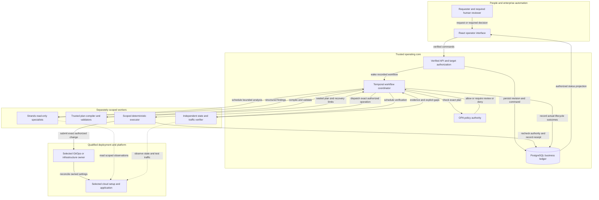

# Architecture Diagram

These diagrams describe the **proposed production operating model**, not the
currently deployed application. They accompany the visual diagrams in the
[leadership brief](../../../../../docs/leadership-brief.html), based on the
[operating core](../../../../../docs/multi-cloud-ingress/core-architecture.md)
and [extension contract](../../../../../docs/multi-cloud-ingress/extension-contract.md).

## Application Architecture

<!-- mermaid-checked: no \n, no em-dash/en-dash, no {} in labels, subgraphs are id["label"], arrows are -->|"label"|, all subgraphs closed by end, ids unique -->

### Technology Stack Summary

| Layer | Technology | Version | Purpose |
|---|---|---|---|
| Operator interface | React / TypeScript | Existing application manifest | Requests, required approvals and inspectable evidence |
| API and domain code | Express / TypeScript / Zod | Existing application manifest | Incremental reuse; enterprise identity remains to implement |
| Analysis | Strands SDK and restricted Harness | Existing declared SDK `^1.26.0`, Harness `^0.5.0`; qualify exact installed releases | Bounded reasoning and approved read tools |
| Durable coordination | Temporal | Proposed; server/SDK versions require approval | Deadlines, restart, retries and durable human waits |
| Business records | PostgreSQL | Proposed; version requires approval | Transactional revisions, authorization, receipts, audit and evidence |
| Policy | OPA / Rego | Proposed; distribution/version requires approval | One strict, versioned authorization authority |
| Deployment | Selected GitOps / infrastructure owner | Proposed; qualify selected product and versions | One effective owner per resource or setting |
| Cloud profiles | Selected AWS, Azure and Google Cloud setups | Proposed; each compatibility set requires evidence | Real provider behavior, independently qualified |

### Data Storage & External Services

The current prototype stores workflow state in local JSON and Strands sessions
locally, with isolated memory in tests. PostgreSQL and Temporal are recommended
production additions, not existing operational foundations. Qualified adapters
connect to the selected cloud, DNS, certificate and deployment services.
Independent observations and traffic checks establish success; a submitted
operation or accepted configuration does not.

### Key Architectural Decisions

- Preserve the modular TypeScript application; give control, analysis and
  execution different identities rather than starting with a service fleet.
- AI proposes and explains. Trusted code, policy and target-scoped authority
  control writes; a human decision cannot override mandatory denial.
- Keep AI out of live traffic. Recovery is bounded and separately authorized,
  and cancellation cannot undo an external request already accepted.

## Component Relationships

```mermaid
flowchart LR
    subgraph CPresentation["Presentation"]
        CRequest["Request and approval interface"]
        CStatus["Outcome and evidence view"]
    end
    subgraph CReasoning["Bounded analysis"]
        CIntake["Intake agent"]
        CDiscovery["Discovery component"]
        CEvidence["Versioned observation set"]
        CSecurity["Security specialist"]
        CImpact["Impact specialist"]
        COptional["Approved optional specialists"]
        CPlanning["Planning agent"]
    end
    subgraph CTrusted["Trusted operating components"]
        CWorkflow["Durable coordinator"]
        CCompiler["Deterministic compiler and validators"]
        CAuthorization["Plan authorization"]
        CReview["Required human review"]
        CStop["Denied or mandatory gap"]
        CExecutor["Scoped executor"]
        CVerifier["Independent verifier"]
        CRecovery["Authorized recovery or escalation"]
    end
    subgraph CData["Protected records"]
        CLedger[("Plans decisions receipts and evidence")]
    end
    CRequest -->|"record verified request"| CWorkflow
    CWorkflow -->|"schedule"| CIntake
    CIntake -->|"confirmed intent"| CDiscovery
    CDiscovery -->|"source and freshness"| CEvidence
    CEvidence -->|"same observations"| CSecurity
    CEvidence -->|"same observations"| CImpact
    CEvidence -->|"same observations"| COptional
    CSecurity -->|"requirements and gaps"| CPlanning
    CImpact -->|"affected users and conflicts"| CPlanning
    COptional -->|"advisory or mandatory findings"| CPlanning
    CPlanning -->|"proposed change"| CCompiler
    CCompiler -->|"exact plan and recovery limits"| CAuthorization
    CAuthorization -->|"denied"| CStop
    CAuthorization -->|"review required"| CReview
    CReview -->|"verified decision then recheck"| CAuthorization
    CAuthorization -->|"currently authorized only"| CExecutor
    CExecutor -->|"receipt then observe"| CVerifier
    CVerifier -->|"verified outcome"| CStatus
    CVerifier -->|"failed or unknown outcome"| CRecovery
    CRecovery -.->|"recheck recovery authority and state"| CAuthorization
    CWorkflow -->|"durable lifecycle records"| CLedger
    CExecutor -->|"immutable operation receipt"| CLedger
    CVerifier -->|"independent evidence"| CLedger
    CLedger -->|"authorized status"| CStatus
```

<!-- mermaid-checked: no \n, no em-dash/en-dash, no {} in labels, subgraphs are id["label"], arrows are -->|"label"|, all subgraphs closed by end, ids unique -->

The coordinator schedules and joins every required step; the diagram emphasizes
artifact handoffs rather than drawing every control arrow. Missing mandatory
evidence stops the affected work. Optional findings do not automatically grant
authority or veto an action. Recovery returns through authorization with a
separate recovery plan and current-state checks, not a blind replay of the
forward plan.

### Component Inventory

| Component | Layer | Type | Responsibility |
|---|---|---|---|
| Request / approval interface | Presentation | Existing experience, production identity pending | Capture intent and required human decisions |
| Outcome / evidence view | Presentation | Existing experience, durable projection proposed | Show observed, simulated, waiting, failed and unknown states |
| Intake / specialists | Analysis | Existing Strands pattern; real evidence integration pending | Interpret and return bounded structured findings |
| Discovery / observation set | Analysis | Proposed authoritative integration | Capture exact target, provenance, completeness and freshness |
| Planning agent | Analysis | Existing pattern, production compilation pending | Propose changes without write authority |
| Durable coordinator | Trusted core | Proposed Temporal workflow | Schedule, join, limit attempts, persist waits and expose deadlines |
| Compiler / validators | Trusted core | Deterministic code, proposed production integration | Build exact artifacts and check selected-profile semantics |
| Plan authorization | Trusted core | Proposed strict OPA authority and application contract | Allow preauthorized work, require review or deny |
| Required human review | Trusted core | Existing review pattern, production identity pending | Decide only within verified authority and plan scope |
| Scoped executor | Trusted core | Proposed real actuator | Recheck permission/state, submit exact operation and retain receipt |
| Independent verifier | Trusted core | Proposed real observation / probes | Establish actual state and user-visible traffic behavior |
| Recovery / escalation | Trusted core | Proposed bounded operating protocol | Observe ambiguous effects and run only authorized compensation |
| Business ledger | Data | Proposed PostgreSQL | Preserve revisions, authorization, receipts, audit and evidence |
