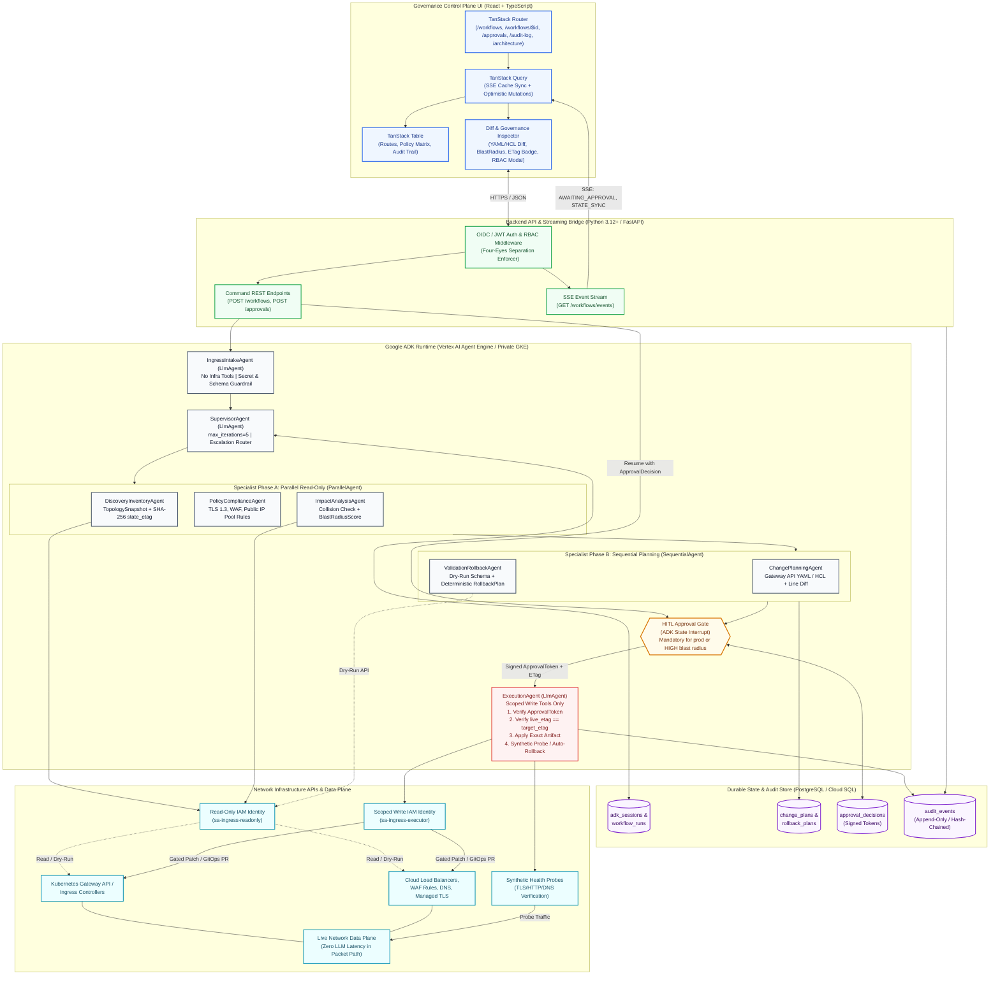
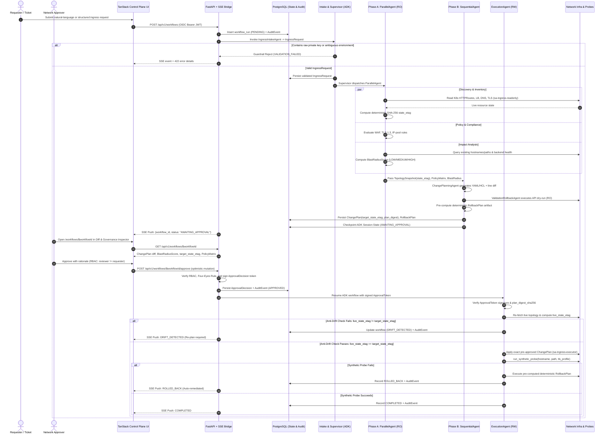

# Governed Multi-Agent Networking Ingress Control Plane — Architectural, Low-Level Design, and Phased Implementation Specification

## 1. System Architecture Diagram

The architecture enforces strict isolation between **read-only analysis agents**, **durable PostgreSQL governance state**, **cryptographically gated write execution**, and the **live network data plane** (ensuring LLM inference latency never sits in the request/packet path).



---

## 2. End-to-End Execution & HITL Sequence Diagram

This sequence illustrates request parsing, parallel read-only analysis, deterministic rollback pre-computation, ADK state interruption, TanStack UI human approval, **TOCTOU ETag anti-drift enforcement**, and automated probe-driven rollback.



---

## 3. Low-Level System Design Document

### 3.1 Pydantic v2 Data Contracts

All agent boundaries and FastAPI endpoints exchange strict, immutable-by-default Pydantic v2 schemas. Secret leakage and raw cryptographic material are blocked at intake.

```python
from __future__ import annotations

import hashlib
import json
import re
from datetime import datetime
from enum import StrEnum
from typing import Any, Literal
from uuid import UUID

from pydantic import BaseModel, ConfigDict, Field, field_validator, model_validator


class Environment(StrEnum):
    DEV = "dev"
    STAGING = "staging"
    PROD = "prod"


class Exposure(StrEnum):
    INTERNAL = "internal"
    EXTERNAL = "external"


class TlsProfile(StrEnum):
    TLS_1_3_STRICT = "tls_1_3_strict"
    TLS_1_2_COMPAT = "tls_1_2_compat"
    MTLS_INTERNAL = "mtls_internal"


class BlastRadiusScore(StrEnum):
    LOW = "LOW"
    MEDIUM = "MEDIUM"
    HIGH = "HIGH"


class WorkflowStatus(StrEnum):
    INTAKE = "INTAKE"
    ANALYZING = "ANALYZING"
    PLANNING = "PLANNING"
    AWAITING_APPROVAL = "AWAITING_APPROVAL"
    APPROVED = "APPROVED"
    REJECTED = "REJECTED"
    DRIFT_ABORTED = "DRIFT_ABORTED"
    EXECUTING = "EXECUTING"
    ROLLED_BACK = "ROLLED_BACK"
    COMPLETED = "COMPLETED"
    FAILED = "FAILED"


SECRET_PATTERNS = (
    re.compile(r"-----BEGIN [A-Z ]*PRIVATE KEY-----"),
    re.compile(r"(?i)(api[_-]?key|secret|password|bearer)\s*[:=]\s*['\"]?[A-Za-z0-9+/=_-]{16,}"),
)


class IngressRequest(BaseModel):
    model_config = ConfigDict(frozen=True, extra="forbid")

    request_id: UUID
    requester_id: str = Field(..., min_length=3, max_length=128)
    ticket_ref: str | None = Field(default=None, max_length=64)
    app_name: str = Field(..., pattern=r"^[a-z0-9]([-a-z0-9]*[a-z0-9])?$", max_length=63)
    environment: Environment
    hostname: str = Field(..., pattern=r"^(?=.{1,253}$)(?:[a-z0-9](?:[a-z0-9-]{0,61}[a-z0-9])?\.)+[a-z]{2,63}$")
    path_prefix: str = Field(..., pattern=r"^/[a-zA-Z0-9/_-]*$")
    backend_service: str = Field(..., pattern=r"^[a-z0-9]([-a-z0-9]*[a-z0-9])?$")
    backend_port: int = Field(..., ge=1, le=65535)
    exposure: Exposure
    tls_profile: TlsProfile
    raw_justification: str = Field(..., min_length=10, max_length=2000)

    @field_validator("raw_justification", "hostname", "backend_service")
    @classmethod
    def reject_embedded_secrets(cls, v: str) -> str:
        for pat in SECRET_PATTERNS:
            if pat.search(v):
                raise ValueError("Input contains prohibited secret or private key material.")
        return v

    @model_validator(mode="after")
    def enforce_prod_tls_baseline(self) -> "IngressRequest":
        if self.environment == Environment.PROD and self.exposure == Exposure.EXTERNAL:
            if self.tls_profile != TlsProfile.TLS_1_3_STRICT:
                raise ValueError("External prod ingress requires tls_1_3_strict.")
        return self


class DiffHunk(BaseModel):
    model_config = ConfigDict(frozen=True)
    file_path: str
    resource_kind: str  # e.g., "HTTPRoute", "ManagedCertificate", "WAFPolicy"
    unified_diff: str
    lines_added: int = Field(ge=0)
    lines_removed: int = Field(ge=0)


class RollbackPlan(BaseModel):
    model_config = ConfigDict(frozen=True)
    rollback_id: UUID
    strategy: Literal["gitops_revert", "declarative_restore", "canary_weight_zero"]
    precomputed_artifacts: dict[str, str]  # filename -> exact prior manifest YAML/HCL
    verification_probes: list[str]
    max_rollback_seconds: int = Field(default=60, ge=10, le=300)


class ChangePlan(BaseModel):
    model_config = ConfigDict(frozen=True)
    plan_id: UUID
    workflow_id: UUID
    target_state_etag: str = Field(..., pattern=r"^sha256:[a-f0-9]{64}$")
    blast_radius: BlastRadiusScore
    policy_violations: list[str] = Field(default_factory=list)
    artifacts: dict[str, str]  # filename -> declarative YAML / HCL
    diffs: list[DiffHunk]
    dry_run_passed: bool
    rollback_plan: RollbackPlan
    plan_digest_sha256: str = Field(..., pattern=r"^[a-f0-9]{64}$")

    @model_validator(mode="after")
    def validate_digest_and_dry_run(self) -> "ChangePlan":
        canonical = json.dumps(
            {
                "target_state_etag": self.target_state_etag,
                "artifacts": self.artifacts,
                "rollback_artifacts": self.rollback_plan.precomputed_artifacts,
            },
            sort_keys=True,
        ).encode("utf-8")
        expected = hashlib.sha256(canonical).hexdigest()
        if self.plan_digest_sha256 != expected:
            raise ValueError("ChangePlan digest mismatch; artifact integrity cannot be verified.")
        return self


class ApprovalDecision(BaseModel):
    model_config = ConfigDict(frozen=True)
    decision_id: UUID
    workflow_id: UUID
    plan_id: UUID
    decision: Literal["APPROVE", "REJECT"]
    reviewer_id: str
    reviewer_roles: list[str]
    rationale: str = Field(..., min_length=12, max_length=1000)
    approved_state_etag: str = Field(..., pattern=r"^sha256:[a-f0-9]{64}$")
    approved_plan_digest: str = Field(..., pattern=r"^[a-f0-9]{64}$")
    signature: str  # HMAC-SHA256 or KMS Ed25519 signature over (workflow_id, plan_id, etag, digest)
    decided_at: datetime


class AuditEvent(BaseModel):
    model_config = ConfigDict(frozen=True)
    event_id: UUID
    workflow_id: UUID
    actor_id: str
    actor_type: Literal["HUMAN", "AGENT", "SYSTEM"]
    event_type: str  # e.g., "INTAKE_VALIDATED", "DRIFT_DETECTED", "PATCH_APPLIED", "ROLLBACK_TRIGGERED"
    payload: dict[str, Any]
    prev_event_hash: str
    event_hash: str
    occurred_at: datetime
```

---

### 3.2 Google ADK Orchestration Patterns & Guardrails

The orchestration graph uses `google.adk.agents` with explicit state keys (`output_key`), callback-based guardrails (`before_model_callback` / `before_tool_callback`), and persistent PostgreSQL session checkpointing for HITL interrupts.

#### Agent Hierarchy & State Flow
1. **`IngressIntakeAgent` (`LlmAgent`)**:
   * `tools=[]` (zero infrastructure access).
   * `output_schema=IngressRequest`, `output_key="ingress_request"`.
   * `before_model_callback` scans prompt payloads for PEM headers, high-entropy tokens, or missing environment context.
2. **`PhaseA_ParallelAnalysis` (`ParallelAgent`)**:
   * Runs three isolated `LlmAgent` workers concurrently, each reading `state["ingress_request"]`:
     * `DiscoveryInventoryAgent` (`tools=[list_k8s_routes, get_lb_config, get_dns_records, get_tls_certs]`, `output_key="topology_snapshot"`). Computes canonical SHA-256 `state_etag` deterministically inside the Python tool (never computed by the LLM).
     * `PolicyComplianceAgent` (`tools=[evaluate_opa_policies]`, `output_key="policy_report"`).
     * `ImpactAnalysisAgent` (`tools=[check_route_collisions, inspect_backend_endpoints]`, `output_key="impact_assessment"`).
3. **`PhaseB_SequentialPlanning` (`SequentialAgent`)**:
   * `ChangePlanningAgent` (`output_key="draft_change_plan"`): Synthesizes declarative YAML/HCL from `topology_snapshot` + `policy_report`.
   * `ValidationRollbackAgent` (`tools=[k8s_server_side_dry_run, terraform_plan_check, compute_deterministic_rollback]`, `output_key="validated_change_plan"`): Executes API dry-run and deterministically builds `RollbackPlan` from the prior live manifests captured in `topology_snapshot`.
4. **`SupervisorAgent` (`LlmAgent`)**:
   * Configured with `max_iterations=5` (hard loop bound enforced via invocation counter in `session.state["iteration_count"]`).
   * Evaluates `validated_change_plan`:
     * If `policy_violations` is non-empty and unresolvable, or `dry_run_passed == False`, transitions to `FAILED` / `ESCALATED` without reaching execution.
     * If `environment == "prod"` or `blast_radius == "HIGH"` (or policy mandates review), emits an ADK HITL state interrupt (`AWAITING_APPROVAL`) and persists session state to PostgreSQL.
5. **`ExecutionAgent` (`LlmAgent`)**:
   * **Pre-Tool Callback Guardrail (`before_tool_callback`)**:
     * Before *any* write tool (`create_gitops_pr`, `apply_gated_ingress_patch`) executes, Python middleware verifies:
       1. A valid, non-expired `ApprovalDecision` exists in `session.state["approval_decision"]`.
       2. Cryptographic signature matches `(workflow_id, plan_id, approved_state_etag, approved_plan_digest)`.
       3. `approved_plan_digest == validated_change_plan.plan_digest_sha256` (prevents LLM prompt-injection or drift between approved and executed YAML).
       4. Live `compute_live_state_etag()` == `approved_state_etag` (TOCTOU lock).
     * If any check fails, the tool raises `SecurityBoundaryError`, aborts execution, and writes a `DRIFT_DETECTED` or `SIGNATURE_INVALID` `AuditEvent`.
   * **Post-Apply Verification**: Calls `run_synthetic_probe`. On failure, invokes `execute_rollback_plan` deterministically using `validated_change_plan.rollback_plan` without re-invoking the LLM.

---

### 3.3 PostgreSQL Database Schema (Durable State & Append-Only Audit Store)

```sql
CREATE EXTENSION IF NOT EXISTS pgcrypto;

-- 1. Workflow & ADK Session Anchor
CREATE TABLE workflow_runs (
    workflow_id         UUID PRIMARY KEY DEFAULT gen_random_uuid(),
    adk_session_id      TEXT NOT NULL UNIQUE,
    ticket_ref          TEXT,
    requester_id        TEXT NOT NULL,
    app_name            TEXT NOT NULL,
    environment         TEXT NOT NULL CHECK (environment IN ('dev', 'staging', 'prod')),
    status              TEXT NOT NULL CHECK (status IN (
                            'INTAKE', 'ANALYZING', 'PLANNING', 'AWAITING_APPROVAL',
                            'APPROVED', 'REJECTED', 'DRIFT_ABORTED', 'EXECUTING',
                            'ROLLED_BACK', 'COMPLETED', 'FAILED'
                        )),
    ingress_request     JSONB NOT NULL,
    current_state_etag  TEXT,
    blast_radius        TEXT CHECK (blast_radius IN ('LOW', 'MEDIUM', 'HIGH')),
    adk_checkpoint      JSONB, -- Serialized ADK InvocationContext state for HITL resume
    created_at          TIMESTAMPTZ NOT NULL DEFAULT now(),
    updated_at          TIMESTAMPTZ NOT NULL DEFAULT now()
);

CREATE INDEX idx_workflow_status_env ON workflow_runs (status, environment, created_at DESC);
CREATE INDEX idx_workflow_app_name ON workflow_runs (app_name);

-- 2. Immutable Change & Pre-Computed Rollback Plans
CREATE TABLE change_plans (
    plan_id             UUID PRIMARY KEY DEFAULT gen_random_uuid(),
    workflow_id         UUID NOT NULL REFERENCES workflow_runs(workflow_id) ON DELETE RESTRICT,
    target_state_etag   TEXT NOT NULL,
    plan_digest_sha256  CHAR(64) NOT NULL,
    blast_radius        TEXT NOT NULL CHECK (blast_radius IN ('LOW', 'MEDIUM', 'HIGH')),
    policy_violations   JSONB NOT NULL DEFAULT '[]'::jsonb,
    artifacts           JSONB NOT NULL, -- { "httproute.yaml": "..." }
    diffs               JSONB NOT NULL,
    rollback_plan       JSONB NOT NULL, -- Pre-computed declarative restore artifacts
    dry_run_passed      BOOLEAN NOT NULL,
    created_at          TIMESTAMPTZ NOT NULL DEFAULT now(),
    UNIQUE (workflow_id, plan_digest_sha256)
);

-- 3. Cryptographically Signed Human Approval Decisions
CREATE TABLE approval_decisions (
    decision_id           UUID PRIMARY KEY DEFAULT gen_random_uuid(),
    workflow_id           UUID NOT NULL REFERENCES workflow_runs(workflow_id) ON DELETE RESTRICT,
    plan_id               UUID NOT NULL REFERENCES change_plans(plan_id) ON DELETE RESTRICT,
    decision              TEXT NOT NULL CHECK (decision IN ('APPROVE', 'REJECT')),
    reviewer_id           TEXT NOT NULL,
    reviewer_roles        TEXT[] NOT NULL,
    rationale             TEXT NOT NULL,
    approved_state_etag   TEXT NOT NULL,
    approved_plan_digest  CHAR(64) NOT NULL,
    signature             TEXT NOT NULL,
    decided_at            TIMESTAMPTZ NOT NULL DEFAULT now()
);

CREATE INDEX idx_approvals_workflow ON approval_decisions (workflow_id, decided_at DESC);

-- 4. Append-Only Tamper-Evident Audit Log
CREATE TABLE audit_events (
    seq_no              BIGSERIAL PRIMARY KEY,
    event_id            UUID NOT NULL UNIQUE DEFAULT gen_random_uuid(),
    workflow_id         UUID NOT NULL REFERENCES workflow_runs(workflow_id) ON DELETE RESTRICT,
    actor_id            TEXT NOT NULL,
    actor_type          TEXT NOT NULL CHECK (actor_type IN ('HUMAN', 'AGENT', 'SYSTEM')),
    event_type          TEXT NOT NULL,
    payload             JSONB NOT NULL,
    prev_event_hash     CHAR(64) NOT NULL,
    event_hash          CHAR(64) NOT NULL UNIQUE,
    occurred_at         TIMESTAMPTZ NOT NULL DEFAULT now()
);

CREATE INDEX idx_audit_workflow_seq ON audit_events (workflow_id, seq_no ASC);

-- Enforce strict append-only immutability at the database engine level
CREATE OR REPLACE FUNCTION prevent_audit_mutation()
RETURNS TRIGGER AS $$
BEGIN
    RAISE EXCEPTION 'audit_events is append-only; UPDATE and DELETE are prohibited.';
END;
$$ LANGUAGE plpgsql;

CREATE TRIGGER trg_audit_no_update
    BEFORE UPDATE OR DELETE ON audit_events
    FOR EACH ROW EXECUTE FUNCTION prevent_audit_mutation();
```

---

### 3.4 RBAC Security Boundaries & Credential Isolation

| Boundary | Principal / Identity | Permitted Operations | Hard Technical Enforcement |
| :--- | :--- | :--- | :--- |
| **Intake & Planning** | `sa-ingress-readonly` | `get`, `list`, `watch` on K8s Gateway/Ingress, Cloud LB, DNS, Certs; `dry-run` only | Kubernetes `ClusterRole` with `get/list` only; GCP IAM custom role lacking `*.update`/`*.create`/`*.delete`. |
| **Approval Gate** | Human OIDC Principal (`NetAdmin`, `SecOps`) | `APPROVE` / `REJECT` workflow plans | FastAPI enforces `reviewer_id != workflow.requester_id` (Four-Eyes Rule) for `prod` and `HIGH` blast radius; requires `role IN ('net-approver', 'platform-sre-lead')`. |
| **Approval Token Minting** | FastAPI Control Plane (KMS / HMAC Signer) | Signs `(workflow_id, plan_id, target_state_etag, plan_digest_sha256, exp)` | Agents have **no access** to the KMS/HMAC signing key; `ExecutionAgent` only holds the public/verification key. |
| **Execution** | `sa-ingress-executor` | `create_gitops_pr`, `apply_gated_ingress_patch`, `run_synthetic_probe` | Short-lived credentials / scoped RBAC limited strictly to ingress namespaces & Gateway/HTTPRoute CRDs (no Secret or IAM write permissions). `before_tool_callback` blocks execution unless signature + ETag match. |

---

### 3.5 TanStack Control Plane UI State Synchronization

* **TanStack Router (Type-Safe Route Tree):**
  * `/workflows` — Filterable queue of all active and historical ingress workflows (`search` schema validates `env`, `status`, `blastRadius`, `app`).
  * `/workflows/$workflowId` — Deep-linkable workflow detail view loading `workflow_run`, `change_plans`, and real-time agent step progress; hosts the **Diff & Governance Inspector** (side-by-side YAML/HCL diff, `BlastRadiusScore` badge, `target_state_etag` vs live ETag freshness indicator, and RBAC-gated Approve/Reject modal requiring rationale ≥ 12 chars).
  * `/approvals` — Dedicated inbox filtered to `status=AWAITING_APPROVAL` sorted by `blast_radius DESC, created_at ASC`.
  * `/audit-log` — Immutable, hash-verified event stream across all workflows with JSON payload inspection and CSV/JSON export.
* **TanStack Query + FastAPI SSE Synchronization:**
  * A top-level `useWorkflowStream()` hook opens an authenticated `EventSource` (`/api/v1/workflows/events`, using `fetch`-based SSE with `Authorization: Bearer` header or short-lived session cookie).
  * On receiving an SSE frame (`{ event_type, workflow_id, status, current_state_etag, updated_at }`):
    1. Immediately patches list & detail caches via `queryClient.setQueryData(['workflow', workflow_id], ...)` for zero-flicker live progress.
    2. Selectively invalidates `['workflows']` and `['audit-log', workflow_id]` via `queryClient.invalidateQueries` when terminal or HITL transitions occur (`AWAITING_APPROVAL`, `DRIFT_ABORTED`, `ROLLED_BACK`, `COMPLETED`).
  * **Optimistic Approve/Reject (`useMutation`):** Optimistically marks the workflow badge as `EXECUTING` (or `REJECTED`) in `onMutate`, snapshots prior cache state, and in `onError` rolls back the optimistic update while surfacing HTTP `409 Conflict` banners when `state_etag` drift or RBAC rejection occurs.
* **TanStack Table:**
  * Uses `@tanstack/react-table` with `getCoreRowModel`, `getSortedRowModel`, `getFacetedRowModel`, and manual server-side pagination for `/audit-log`.
  * **Active Ingress Routes Table:** Displays `app_name`, `environment`, `hostname + path_prefix`, `exposure`, `tls_profile`, `waf_status`, and `live_state_etag` truncation with click-to-copy.
  * **Policy Compliance Matrix:** Matrix view mapping each `IngressRequest` against corporate controls (`WAF_ATTACHED`, `TLS_1_3`, `NON_WILDCARD_PROD_CERT`, `PRIVATE_POOL_ISOLATION`).

---

## 4. Phased Implementation Plan

### Phase v1: Read-Only Advisory + TanStack Telemetry UI
**Objective:** Deliver full discovery, compliance evaluation, diff synthesis, and governance visibility with **zero automated write capability**.

* **Milestones:**
  1. **Foundation & Contracts:** Initialize Python 3.12+ FastAPI service, Pydantic v2 schemas (`IngressRequest`, `ChangePlan`, `AuditEvent`), PostgreSQL schema migrations (Alembic), and hash-chained `audit_events` trigger.
  2. **Read-Only ADK Pipeline:** Provision `sa-ingress-readonly`. Implement `IngressIntakeAgent`, `SupervisorAgent`, `ParallelAgent` (Discovery, Policy, Impact), and `SequentialAgent` (ChangePlanning + ValidationRollback with dry-run API checks).
  3. **Deterministic ETag & Diff Engine:** Implement canonical JSON/YAML normalization and SHA-256 `state_etag` hashing across K8s Gateway API, DNS, LB, and TLS cert snapshots.
  4. **SSE Bridge & TanStack UI:** Build FastAPI SSE broadcaster and React UI with TanStack Router (`/workflows`, `/workflows/$workflowId`, `/audit-log`), TanStack Table, and side-by-side YAML/HCL diff + `BlastRadiusScore` inspector (Approve/Reject buttons disabled or labeled *"Advisory Export Only"*).
* **Testing & Validation Gates:**
  * *Security Gate:* Automated unit tests proving `IngressRequest` rejects PEM private keys, bearer tokens, and `TLS_1_2_COMPAT` on external `prod` routes.
  * *IAM Gate:* Penetration/dry-run test confirming `sa-ingress-readonly` fails with `403 Forbidden` on any `PATCH`/`POST` mutation against K8s or Cloud APIs.
  * *Determinism Gate:* Repeated snapshots of unchanged infrastructure produce bit-for-bit identical `state_etag` values.
  * *UI Sync Gate:* Verify SSE reconnect recovery (`Last-Event-ID`) re-hydrates TanStack Query caches without stale status.
* **Deployment Steps:**
  * Deploy Cloud SQL PostgreSQL with private IP; deploy FastAPI + ADK runtime to private GKE/Cloud Run; host TanStack SPA behind corporate Identity-Aware Proxy (IAP/OIDC).

---

### Phase v2: GitOps PR Execution + HITL Gate
**Objective:** Enable governed write execution via GitOps Pull Requests, gated by the ADK HITL state interrupt, signed human approval, and TOCTOU ETag verification.

* **Milestones:**
  1. **ADK HITL Interrupt & Checkpointing:** Wire ADK session pause/resume to PostgreSQL `workflow_runs.adk_checkpoint` so workflows suspend cleanly at `AWAITING_APPROVAL` and survive API pod restarts.
  2. **Approval Signing & Four-Eyes RBAC:** Implement OIDC role verification, `requester_id != reviewer_id` enforcement, KMS/HMAC `ApprovalDecision` signing, and the TanStack `/approvals` queue + Approve/Reject rationale modal.
  3. **Scoped `ExecutionAgent` (GitOps Only):** Grant `ExecutionAgent` access exclusively to `create_gitops_pr` (scoped bot token able to open PRs on a dedicated `ingress-configs` branch, with branch protection requiring CI checks).
  4. **Anti-Drift TOCTOU Gate:** Implement `before_tool_callback` re-computing `live_state_etag` right before PR creation; abort and transition to `DRIFT_DETECTED` if `live_state_etag != approved_state_etag`.
* **Testing & Validation Gates:**
  * *TOCTOU Chaos Test:* Modify a live K8s `HTTPRoute` annotation *while* a workflow sits in `AWAITING_APPROVAL`; approve in UI and verify `ExecutionAgent` aborts with `DRIFT_ABORTED` and zero PR created.
  * *Signature Tamper Test:* Mutate 1 byte of `ChangePlan.artifacts` in DB after approval; confirm `ExecutionAgent` halts on `plan_digest_sha256` mismatch.
  * *RBAC Gate:* Verify requester cannot approve their own `prod` or `HIGH` blast-radius change (`403 Forbidden`).
* **Deployment Steps:**
  * Provision KMS signing key and GitOps bot credential in Secret Manager; enable Atlantis/ArgoCD/Flux reconciliation on the target Git repository; roll out v2 behind a per-environment feature flag (`dev` -> `staging` -> `prod`).

---

### Phase v3: Direct Gated Execution + Automated Canary Rollback
**Objective:** Enable direct scoped API execution (`apply_gated_ingress_patch`) with progressive traffic shifting, real-time synthetic probes, and deterministic zero-LLM-latency rollbacks.

* **Milestones:**
  1. **Scoped Executor Identity:** Provision `sa-ingress-executor` with namespace/resource-scoped write permissions (`HTTPRoute`, `Gateway`, `WAFPolicy` patches only) and short-lived credential issuance tied to a verified `ApprovalDecision`.
  2. **Progressive Traffic Shifting:** Extend `ChangePlanningAgent` and `ExecutionAgent` to stage Gateway API backend weights (`10% -> 50% -> 100%`) or canary DNS weights with probe gates between steps.
  3. **Synthetic Probe Suite:** Implement `run_synthetic_probe` checking DNS resolution, TLS 1.3 handshake/cert SANs, HTTP status codes, and WAF rule enforcement from outside/inside the VPC.
  4. **Deterministic Auto-Rollback:** Wire probe failures to execute `RollbackPlan.precomputed_artifacts` directly in Python (bypassing LLM inference completely) within `max_rollback_seconds` (≤ 60s), emitting `ROLLED_BACK` SSE alerts and immutable `AuditEvent` records.
* **Testing & Validation Gates:**
  * *Failure-Injection Canary Test:* Deploy a synthetic misconfigured backend returning HTTP `503` at 10% canary traffic; verify `run_synthetic_probe` catches failure and restores prior manifest deterministically in < 60 seconds without LLM calls.
  * *Audit Chain Verification Gate:* Run a verifier job walking `audit_events` from `seq_no=1..N` confirming `prev_event_hash` continuity and `UPDATE`/`DELETE` rejection.
  * *Load & Concurrency Gate:* Simulate concurrent approvals targeting overlapping hostnames; verify ETag locking allows only the first change to apply while cleanly flagging the second as `DRIFT_ABORTED`.
* **Deployment Steps:**
  * Deploy external/internal synthetic probe runners; enforce canary rollout policies in `staging` for 2 weeks before enabling direct gated execution for `prod`; integrate `ROLLED_BACK` and `DRIFT_ABORTED` events with PagerDuty/Slack alerting webhooks.
