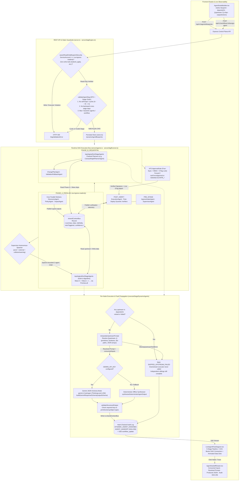

# DAG Execution Bus & Structured Output Chaining Architecture

This document illustrates how the **Ingress Control Plane** orchestrates dynamic read-only agents (`DynamicAgentBlueprint`), enforces strict security boundaries (`sa-ingress-readonly`), schedules dependency waves topologically, routes typed JSON payloads across the **Shared Context Bus**, and propagates safety vetoes in real time.

---

## 1. End-to-End DAG Execution Bus Diagram



---

## 2. Shared Context Bus & Interpolation Flow (ASCII View)

```text
  Upstream Agents (Phase A / Earlier Wave)
  ┌──────────────────────────────┐     ┌───────────────────────────────┐
  │ TLSInspectorAgent            │     │ ImpactAgent                   │
  │ data: {                      │     │ data: {                       │
  │   minTlsVersion: "TLSv1.3",  │     │   blastRadius: "MEDIUM",      │
  │   expiringWithinDays: 9,     │     │   hasCollision: false         │
  │   sanList: ["api.corp.com"]  │     │ }                             │
  │ }                            │     └───────────────┬───────────────┘
  └──────────────┬───────────────┘                     │
                 │                                     │
                 ▼                                     ▼
  ┌─────────────────────────────────────────────────────────────────────┐
  │                    sharedContextBus[agentName]                      │
  │  Typed AgentStructuredOutput Envelopes + Core Agent Alias Lookup    │
  └──────────────────────────────────┬──────────────────────────────────┘
                                     │
         interpolateUpstreamPrompt() │ resolves {{upstream.<agent>.<field>}}
                                     ▼
  ┌─────────────────────────────────────────────────────────────────────┐
  │ CanaryWeightPlannerAgent (PHASE_B_SEQUENTIAL)                       │
  │ taskTemplate: "Plan canary given expiry={{upstream.TLSInspectorAgent│
  │                .expiringWithinDays}}d & risk={{upstream.ImpactAgent │
  │                .blastRadius}}"                                      │
  │ resolvedTaskPrompt: "Plan canary given expiry=9d & risk=MEDIUM"     │
  │                                                                     │
  │ Output Schema Validated -> { recommendedCanaryPercent: 10, ... }    │
  └──────────────────────────────────┬──────────────────────────────────┘
                                     │
                                     ▼
  ┌─────────────────────────────────────────────────────────────────────┐
  │ SHA-256 Audit Chain (AGENT_HANDOFF) + SSE Broadcast -> UI Drawer    │
  └─────────────────────────────────────────────────────────────────────┘
```

---

## 3. Veto & Fault Propagation Semantics

When an upstream node returns `vetoTriggered: true` (or violates `validateStructuredOutput` / `MissingUpstreamFieldError`):

1. **Downstream Halt:** Any downstream blueprint listing the vetoed node in `dependsOn` is immediately transitioned to `SKIPPED_UPSTREAM_FAILED` — its LLM/tool executor is **never invoked**.
2. **Sibling Isolation:** Independent parallel branches in the same `WorkflowHookStage` wave continue executing via `Promise.all`.
3. **Human Gate Escalation:** If a dynamic node sets `riskDelta: "ELEVATE_HIGH"` or `canForceApproval: true`, the workflow automatically pauses at `HITLApprovalGate` even when `hitlPolicy` is set to `auto_low_risk`.

---

## 4. Implementation Module Map

| Layer | File | Responsibility |
| :--- | :--- | :--- |
| **Contracts** | `src/shared/contracts.ts` | `WorkflowHookStage`, `ReadOnlyToolId`, `OutputFieldDefinition`, `AgentStructuredOutput`, `DynamicAgentBlueprint`, `DynamicTaskAssignment`, `WorkflowRun` extensions |
| **Pure DAG Engine** | `server/dagEngine.ts` | Read-only security assertions, DFS cycle detection, stage-order checks, Kahn's topological wave sorting, dot-path prompt interpolation, schema validation |
| **Stage Runner** | `server/dagRunner.ts` | Concurrent wave execution (`Promise.all`), veto propagation, Gemini JSON Schema mode + deterministic fallback, Supervisor autonomous 2-agent spawning |
| **Store & Orchestrator** | `server/store.ts`, `server/agents.ts` | Default chained blueprints (`TLSInspectorAgent` → `CanaryWeightPlannerAgent`), `assignAgentToWorkflow`, revision preservation, SHA-256 `AGENT_HANDOFF` audit events |
| **REST API & Client** | `server.ts`, `src/lib/api.ts` | Blueprint CRUD (`/api/v1/agents/blueprints`), runtime workflow hooking (`/api/v1/workflows/:workflowId/assign-agent`), `createApp()` factory |
| **Frontend UI** | `src/components/agents/AgentStudioBuilder.tsx`, `src/components/agents/AgentHandoffDrawer.tsx`, `src/components/LiveAgentFlowDiagram.tsx` | Authoring studio, clickable `{{upstream.*}}` chips, live SVG Bezier DAG connectors with animated data particles, and handoff telemetry drawer |
| **Tests** | `server/__tests__/agentDag.test.ts` | 12 Vitest unit & integration specs covering cycles, waves, interpolation, schema checks, veto propagation, and REST endpoints |
